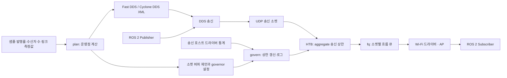

# ROSPacer

**ROS 2의 대용량 DDS 데이터를 Wi-Fi 링크의 처리 능력에 맞춰 보내기 위한 정적 설정 생성기와 송신 측 pacing 제어기입니다.**

현재 버전은 **0.1.0 연구용 초기 구현**이며, 실험 환경은 **Ubuntu 22.04 / ROS 2 Humble**입니다. Fast DDS와 Cyclone DDS를 먼저 지원하고, 이후 Zenoh를 추가하는 것을 목표로 합니다.

> **검증 상태:** 정적 XML 생성과 HTB·fq 기반 고정 속도 제어는 실제 12→10 노트북에서 점검했습니다. 적응형 제어의 계산·수집 코드는 구현되어 있지만, 현재 NIC가 필요한 airtime 통계를 제공하지 않아 실제 Wi-Fi 적응형 동작은 검증하지 못했습니다. 장시간·과부하·단절에서의 전체 전달과 복구 시간 보장도 후속 검증 대상입니다.

## 목차

- [목적과 연구 배경](#목적과-연구-배경)
- [시스템 구조와 동작](#시스템-구조와-동작)
- [현재 지원 범위](#현재-지원-범위)
- [설치와 작업 디렉터리](#설치와-작업-디렉터리)
- [12번 Publisher와 10번 Subscriber 실행](#12번-publisher와-10번-subscriber-실행)
- [적응형 제어 준비](#적응형-제어-준비)
- [CLI와 생성 파일](#cli와-생성-파일)
- [모델과 구현상 가정](#모델과-구현상-가정)
- [검증 결과와 한계](#검증-결과와-한계)
- [파일 구조와 개발 계획](#파일-구조와-개발-계획)

## 목적과 연구 배경

2026-10-13 추가 구현: Receiver-assisted 경로를 유지하고
[송신 측 수동 관측 프로토타입](docs/sender-only-prototype.md)을 별도로 추가했다.
두 DDS의 무경쟁 shadow 추정은 확인했으나 B2에서 중계 가시성이 부족해
보류했다. `adaptive-sender`의 자동 HTB 갱신은 아직 승인하지 않았다.

B2 누락 진단에서 CRC 오류 경로와 CTS 필터 누락을 확인하고, sender monitor에
오류 계수·RTS/CTS/BA 후보 로그를 추가했다. 전체 누락과 제어 교환의 시간 의미는
미확정이어서 CRC 오류 byte/NAV를 제어 입력으로 승격하지 않는다. 새 증거는
`runs/w1_20261013_sender_gap` 및 `W1 송신 관측 누락 진단_261013.html`에 있다.

카메라 영상이나 LiDAR처럼 큰 ROS 메시지는 DDS에서 여러 UDP 데이터그램으로 나뉩니다. 응용의 발행 주기가 일정해도, 한 샘플의 데이터그램은 짧은 시간에 집중되어 송신 큐에 들어갈 수 있습니다. Wi-Fi에서는 링크 용량 변화, 다른 트래픽과의 경쟁, 패킷 손실과 재전송이 겹쳐 적체와 지연이 커질 수 있습니다.

ROSPacer는 다음 두 작업을 결합합니다.

1. **배치 전 정적 최적화:** 샘플 크기·발행률·수신자 수·링크 처리량·RTT·허용 복구 시간으로 전송 단위, 피드백 주기, 보관량, 소켓 버퍼와 초기 송신 상한을 계산합니다.
2. **실행 중 송신 제어:** Linux HTB와 fq를 사용해 UDP 전송을 시간에 걸쳐 펼칩니다. 적응형 모드에서는 송신 호스트의 드라이버 통계로 상한을 다시 계산하도록 설계했습니다.

연구 방향은 *Optimizing ROS 2 Communication for Wireless Robotic Systems*의 Fast DDS 정적 최적화를 확장하는 것입니다. `WirelessXML_Proposal (2).html`의 IV-A/IV-B/IV-C를 구현 기준으로 삼았으며, proposal의 Ubuntu 24.04/Jazzy 표기와 달리 이 저장소는 Ubuntu 22.04/Humble을 대상으로 개발합니다. 논문·proposal 원문은 이 저장소에 포함하지 않습니다.

미들웨어 소스를 수정하지 않고 **벤더별 설정 파일과 송신 호스트의 Linux traffic control**을 사용합니다. ROSPacer는 새로운 RMW 구현이나 메시지를 대신 전달하는 ROS 중계 노드가 아닙니다.

## 시스템 구조와 동작



### 정적 설정 생성

`python3 -m rospacer plan`은 입력값으로 부하와 pacing 상한을 계산하고, 벤더 XML과 커널 설정 제안 파일을 생성합니다. **파일 생성만 수행하며 XML·sysctl·qdisc를 자동 적용하지 않습니다.** 현재 링크 처리량과 RTT는 사용자가 입력합니다. iperf3/ping 결과의 자동 분석은 아직 구현하지 않았습니다.

### HTB와 fq의 역할

현재 qdisc 구성은 다음과 같습니다.

```text
Wi-Fi 인터페이스
└── HTB root 7ac0:
    ├── class 7ac0:10: 지정한 RTPS 흐름의 합산 rate/ceil 제한
    │   └── fq 7ac1:: 소켓별 흐름 큐, nopacing
    └── class 7ac0:20: 나머지 트래픽 bypass
```

HTB가 합산 송신 상한과 burst를 정하고, 그 아래 fq가 흐름을 나눠 내보냅니다. 현재 fq 자체의 추가 pacing은 끄고 HTB를 상한 제어에 사용합니다. 작은 발견·피드백 흐름이 대용량 흐름 하나 뒤에 계속 갇히는 상황을 줄이는 것이 의도입니다.

현재 분류기는 **지정 peer 또는 `239.255.0.1`로 보내는 UDP 중 페이로드 첫 4바이트가 `RTPS`인 패킷**을 제어합니다. IPv4 헤더 길이 20 B이고 IP fragmentation이 없는 경우에 한정합니다. SSH/TCP와 일반 UDP는 bypass합니다. 특정 ROS 프로세스나 토픽을 식별하는 기능은 아니므로 같은 목적지로 보내는 다른 RTPS 흐름도 포함합니다. IPv6·IP option·IP fragmentation 경로는 현재 분류 범위에 포함하지 않습니다. DDS Security나 VPN·터널 환경의 동작은 검증하지 않았습니다.

### 고정 모드와 적응형 모드

| 모드 | 동작 | 현재 상태 |
|---|---|---|
| `fixed` | `governor.json`의 초기 상한을 유지하고 qdisc 통계를 기록 | 실제 Wi-Fi 기능 점검 완료 |
| `adaptive` | 드라이버 통계 delta로 링크 몫을 추정해 상한을 갱신 | 계산 코드·단위 검사 구현, 실제 Wi-Fi 검증 미완료 |

제어 주기는 현재 코드에서 **200 ms**로 고정되어 있습니다. 적응형 모드는 계산한 새 상한을 이전 상한과 `0.7 × 이전값 + 0.3 × 새값`으로 평활화하며, 현재 구현은 packet rate를 최소 1,000 B/s로 유지합니다. 따라서 모델의 상한이 0에 가까운 극단적인 조건에서 정확히 0으로 멈추는 제어는 아닙니다.

송신이 늦어졌을 때 qdisc→소켓→DDS 보관함→`publish()`로 역압이 전달되는 것이 연구의 핵심 경로입니다. **실제 UDP memory accounting, qdisc 드롭, 미들웨어 발행 모드에 따라 이 경로가 달라질 수 있으므로 관측으로 확인해야 합니다.**

## 현재 지원 범위

| 기능 | 지원 범위 |
|---|---|
| OS / ROS | Ubuntu 22.04 / ROS 2 Humble, Python 3.10 이상 |
| 미들웨어 | Fast DDS, Cyclone DDS |
| 전송 | IPv4 UDP, MTU 1500 기준 |
| 응용 의미론 | `complete` / `latest`; 실제 ROS QoS도 응용에서 설정 필요 |
| 토픽 | 단일 토픽 운영점 계산 |
| 수신자 | CLI에서 여러 `--peer` 입력 가능; 실제 시험은 1:1만 수행 |
| 관측 | NIC·커널·qdisc 진단, station/survey 통계, governor CSV |
| 설정 검증 | XSD 검증과 실제 송신 측 라이브러리 로딩 점검 |
| 아직 미지원 | Zenoh, TCP/IPv6 pacing, 다중 토픽 합성, golden profile, 자동 링크 식별 |

`complete`라는 이름은 KEEP_ALL을 선택하는 의도입니다. 제한된 캐시나 발행 timeout에서 모든 샘플의 전달을 자동 보증한다는 뜻은 아닙니다.

## 설치와 작업 디렉터리

ROS 2 Humble과 해당 RMW가 먼저 설치되어 있어야 합니다. 이미 소스 overlay로 Cyclone DDS를 사용 중이라면 해당 overlay를 활성화합니다. ROSPacer는 DDS를 다시 빌드하거나 설치하지 않습니다.

새 환경에서는 다음 위치에 clone합니다.

```bash
mkdir -p ~/ros2_ws/src/large_data_1009
cd ~/ros2_ws/src/large_data_1009
git clone https://github.com/taehun25/ROSPacer.git
cd ROSPacer
mkdir -p runs profiles
```

12·10번에 이미 개발용 폴더가 있다면 그 폴더를 지우거나 덮어 clone하지 않습니다. 기존 소스·결과를 보관한 뒤 Git checkout과 동기화합니다.

일반 실행은 Python 표준 라이브러리로 가능하며, XML 스키마 검증에만 lxml이 필요합니다.

```bash
sudo apt-get update
sudo apt-get install iw iproute2 iperf3 python3-lxml
python3 -m rospacer --help
python3 -m rospacer --version
```

선택적으로 Python 환경에 설치하면 `rospacer` 명령도 사용할 수 있습니다.

```bash
python3 -m pip install -e '.[validation]'
rospacer --help
```

아래 실행 예는 저장소 루트에서 `python3 -m rospacer`를 사용하는 방식입니다. venv에 설치했다면 sudo로 실행할 때도 같은 Python을 사용하는지 확인해야 합니다. qdisc 변경은 Linux 관리자 권한이 필요하지만, 모델 계산·설정 생성·스키마 검증은 일반 사용자로 실행합니다.

실험 산출물은 `~/ros2_ws/src/large_data_1009/ROSPacer/runs/`, 배치 설정은 `profiles/`에 모읍니다. `runs/`, `profiles/`, Python 캐시와 빌드 산출물은 Git에서 제외합니다. `/run/rospacer-<dev>.lock`은 중복 제어를 막는 일시적인 시스템 잠금 파일입니다.

## 12번 Publisher와 10번 Subscriber 실행

다음 값은 현재 SR2 배치 예입니다. 다른 장비에서는 주소·인터페이스를 바꿉니다. **노트북 번호 12/10과 현재 IP의 끝자리는 다릅니다.**

| 노트북 | 역할 | 현재 주소 | Wi-Fi 인터페이스 |
|---|---|---|---|
| 12 | Publisher + governor | `192.168.0.3` | `wlo1` |
| 10 | Subscriber | `192.168.0.4` | `wlp2s0` |

### 1. 환경 진단

각 노트북에서 저장소 루트로 이동하고 실행합니다.

```bash
# 12번
python3 -m rospacer doctor --dev wlo1 --out runs/doctor12.json
python3 -m rospacer probe --dev wlo1 --seconds 3 --out runs/probe12.json
tc qdisc show dev wlo1
iw dev wlo1 survey dump

# 10번
python3 -m rospacer doctor --dev wlp2s0 --out runs/doctor10.json
```

`doctor`와 `probe`는 설정을 바꾸지 않습니다. 현재 governor는 기존 root qdisc가 **noqueue**인 배치만 지원합니다. fq_codel/mq/netem 등 다른 root가 있으면 덮어쓰지 않고 시작을 거부합니다.

### 2. 링크 입력값 준비

다른 트래픽이 없는 조건에서 단말 간 처리량과 RTT를 별도로 측정합니다. 아래는 측정 명령 예이며, 결과를 ROSPacer가 자동으로 읽지는 않습니다.

```bash
# 10번: 한 연결 후 종료
iperf3 -s -1 -p 5209 > runs/iperf_server.log 2>&1

# 12번: 다른 터미널에서
iperf3 -c 192.168.0.4 -p 5209 -t 10 -J > runs/iperf_sender.json
ping -c 20 192.168.0.4 > runs/ping12.log
```

iperf TCP goodput은 초기 처리량 추정에 사용할 수 있지만, DDS UDP의 전송 단위·헤더·재전송 조건과 같다고 가정하면 안 됩니다. 모델 식별에서는 바이트 계층과 시험 조건을 맞추고 추정 오차를 확인해야 합니다.

### 3. 벤더 설정 생성

아래의 **200Mbps, 4ms는 설명용 입력값**이며 이 배치의 측정값이 아닙니다.

```bash
# 12번: Cyclone DDS
python3 -m rospacer plan --rmw cyclonedds \
  --payload 1MiB --rate 10 --readers 1 \
  --share 200Mbps --rtt 4ms --tau 1s --intent complete \
  --dev wlo1 --address 192.168.0.3 --peer 192.168.0.4 \
  --out profiles/cyclonedds12 > runs/plan_cyclonedds12.json

# 10번: 해당 수신 인터페이스와 반대쪽 peer로 별도 생성
python3 -m rospacer plan --rmw cyclonedds \
  --payload 1MiB --rate 10 --readers 1 \
  --share 200Mbps --rtt 4ms --tau 1s --intent complete \
  --dev wlp2s0 --address 192.168.0.4 --peer 192.168.0.3 \
  --out profiles/cyclonedds10 > runs/plan_cyclonedds10.json
```

Fast DDS는 같은 인수에서 `--rmw fastdds`와 출력 폴더 이름을 바꿉니다. 수신자 설정에서도 토픽 입력은 Publisher가 제공하는 샘플 크기·발행률입니다.

생성 파일은 `middleware.xml`, `env.bash`, `sysctl.conf`, `governor.json`입니다. `sysctl.conf`는 제안일 뿐 자동 적용하지 않습니다.

### 4. XML과 소켓 버퍼 확인

```bash
python3 -m rospacer validate \
  --xml profiles/cyclonedds12/middleware.xml \
  --schema reference/cyclonedds-0.10.5.xsd

# Fast DDS 검증 예
python3 -m rospacer validate \
  --xml profiles/fastdds12/middleware.xml \
  --schema reference/fastdds-2.6.10-local-validation.xsd
```

sysctl을 적용하려면 해당 호스트에서 원래 값을 저장하고, 그 호스트의 생성 파일을 사용합니다. 예를 들어 12번의 Cyclone DDS 설정은 다음처럼 시험 동안 적용·복원할 수 있습니다.

```bash
sysctl net.core.wmem_max net.core.rmem_max > runs/sysctl_before.txt
sudo sysctl -p profiles/cyclonedds12/sysctl.conf > runs/sysctl_apply.log
# 시험 종료 후 아래 명령으로 원래 값 복원
sudo sysctl -p runs/sysctl_before.txt > runs/sysctl_restore.log
```

커널 상한 변경은 기존 DDS 소켓을 소급해 다시 설정하지 않습니다. 버퍼 적용 후 ROS 프로세스를 시작하고 `ss -u -m` 등으로 실제 소켓 메모리를 확인합니다. Linux 소켓 버퍼 보고값과 요청값의 accounting 차이도 고려해야 합니다. Cyclone DDS는 XML의 최소 버퍼를 확보하지 못하면 시작에 실패할 수 있습니다.

현재 실험실 10번의 `csi` 계정에는 `tools/enable_receiver_sudo.sh`로 제한된 비밀번호 없는 sudo를 설정했습니다. 허용 명령은 수신 상한 조회, `rmem_max=1048576` 적용과 `212992` 복원, `wlp2s0`의 survey/station 조회, 권한 확인용 true입니다. 일반 root shell이나 임의 sysctl 명령을 허용하지 않습니다. 이 스크립트는 해당 노트북·계정·작업 경로에 한정되며 최초 실행에는 계정 비밀번호가 필요합니다. `/etc/sudoers.d/rospacer-csi`는 시스템 권한 설정이고, 설정 후보와 결과물은 저장소 아래 `runs/sudo_setup/`에 보관합니다.

### 5. ROS 환경과 XML 활성화

양쪽 모두 같은 RMW와 `ROS_DOMAIN_ID`를 사용합니다. overlay는 존재하는 환경에서만 source합니다.

```bash
source /opt/ros/humble/setup.bash
source ~/ros2_ws/install/setup.bash
export ROS_DOMAIN_ID=71

# 12번
source profiles/cyclonedds12/env.bash
# 10번에서는 profiles/cyclonedds10/env.bash를 source
```

`env.bash`는 RMW와 해당 XML 경로를 설정합니다. 실행 중인 ROS 노드의 환경은 바뀌지 않으므로, source한 터미널에서 새 프로세스를 시작합니다. 미들웨어를 바꿀 때는 새 터미널에서 환경을 준비하면 이전 RMW 설정의 영향을 줄일 수 있습니다. 응용의 QoS가 XML을 덮어쓸 수 있으므로 실제 history/reliability도 확인합니다.

### 6. Subscriber → governor → Publisher 순서로 실행

10번에서 먼저 Subscriber를 실행합니다.

```bash
python3 tools/traffic.py sub --bytes 1048576 --hz 10 --count 20 \
  --seconds 30 --intent complete --out runs/sub.json
```

12번의 별도 터미널에서 governor를 실행합니다. 저장소 루트로 이동한 상태에서 실행합니다.

```bash
python3 -m rospacer govern --config profiles/cyclonedds12/governor.json \
  --mode fixed --seconds 20 --trace runs/govern.csv --dry-run

sudo python3 -m rospacer govern --config profiles/cyclonedds12/governor.json \
  --mode fixed --seconds 20 --trace runs/govern.csv
```

12번에서 ROS 환경과 XML을 활성화한 다른 터미널로 Publisher를 실행합니다.

```bash
python3 tools/traffic.py pub --bytes 1048576 --hz 10 --count 20 \
  --seconds 15 --intent complete --out runs/pub.json
```

이 테스트 도구는 `/rospacer_smoke`의 `UInt8MultiArray`를 사용합니다. payload 앞 16 B에 sequence와 송신 시각을 넣습니다. Publisher는 수신자 매칭을 기다리고, 발행 뒤 최대 3초 동안 outstanding ACK를 기다립니다. `--seconds`는 내부 실행 기한이므로, `publish()`가 막히면 정한 샘플 수에 도달하지 못할 수 있습니다.

로그는 발행 호출 시간, 고유 수신 sequence, 누락·중복, 수신 monotonic timestamp를 기록합니다. **호스트 시계를 맞추지 않았기 때문에 E2E latency는 계산하지 않습니다.** RP Bench는 필수 의존성이 아니며, 논문용 반복 실험과 지표 집계에는 더 충분한 측정 도구가 필요합니다.

### 7. 종료와 복원

governor는 지정 시간 종료, SIGINT/SIGTERM, 일반 예외에서 자신이 추가한 qdisc를 제거합니다. sysctl은 governor가 자동 복원하지 않으므로 위에서 저장한 값으로 별도 복원합니다.

```bash
tc qdisc show dev wlo1
```

SIGKILL 등으로 제어기가 강제 종료되어 qdisc가 남았다면 다음 명령을 사용합니다.

```bash
sudo python3 -m rospacer restore --dev wlo1
```

`restore`는 잠금을 확인하고 ROSPacer의 `7ac0:` root가 있을 때만 제거합니다. 다른 root qdisc를 제거하지 않습니다.

## 적응형 제어 준비

적응형 모드는 다음 sender-side 관측이 모두 필요합니다.

| 관측 | 사용 |
|---|---|
| active/busy/transmit channel time | 채널 점유와 자기 송신 시간의 delta |
| TX bytes/packets/retries | 송신량과 재시도 비율의 추정 |
| TX/RX PHY bitrate | airtime 모델의 rate 입력 |
| AP relay가 busy counter에 포함되는지 여부 | 자기 트래픽을 외부 경쟁으로 오인하지 않기 위한 보정 |

현재 12번의 iwlwifi와 10번의 rtw89_8852be에서는 `iw survey dump`가 비어 있습니다. 12번에서 root로 실행해도 동일했습니다. PHY rate만 제공된다고 적응형 제어가 가능한 것은 아닙니다.

통계가 확보된 환경에서는 다음 명령으로 입력한 링크 처리량과 PHY rate에 맞춰 고정 airtime 비용 O를 식별합니다. 아래 rate와 retry는 모두 예시입니다. `--retries`는 횟수가 아닌 **재시도/패킷 비율**입니다. `--relay-in-survey yes/no`는 실제 관측을 통해 선택해야 하며, 단순히 오류를 피하려고 no를 선택하면 안 됩니다.

```bash
python3 -m rospacer calibrate --config profiles/cyclonedds12/governor.json \
  --tx-rate 800Mbps --rx-rate 800Mbps --retries 0.1 --relay-in-survey yes

sudo python3 -m rospacer govern --config profiles/cyclonedds12/governor.json \
  --mode adaptive --seconds 30 --trace runs/adaptive.csv
```

`calibrate`는 설정 JSON을 갱신하며 iperf나 드라이버 계수기를 자동 식별하지 않습니다. 현재 RX PHY rate는 AP→송신 호스트에서 읽은 값을 AP relay downlink의 proxy로 사용합니다. AP→실제 수신자 rate와 같다는 보장은 없으며, 이 가정과 relay 추정을 검증해야 합니다. 1:N의 서로 다른 수신 링크를 개별 식별하는 구현도 아직 없습니다.

필수 통계가 처음부터 없으면 **qdisc를 설치하기 전에 시작을 거부**합니다. 실행 중 통계가 없어지거나 reset/stale/유효하지 않은 delta가 감지되면 마지막 상한을 유지하고 CSV에 `hold` 이유를 남깁니다. 결측값을 busy=0으로 대체하지 않습니다. 수신 측 피드백은 사용하지 않습니다.

## CLI와 생성 파일

| 명령 | 기능 | 시스템 변경 |
|---|---|---|
| `plan` | 운영점·XML·sysctl 제안·governor JSON 생성 | 출력 파일만 생성 |
| `doctor` | OS·NIC·드라이버·도구·qdisc·버퍼·무선 통계 진단 | 없음 |
| `probe` | nominal 200 ms 간격의 무선 통계 JSON 수집 | 없음 |
| `validate` | 지정 XML의 XSD 검증 | 없음 |
| `calibrate` | 입력한 측정값으로 O 식별 및 relay 플래그 기록 | 설정 JSON 갱신 |
| `govern` | HTB·fq 설치·기록·상한 유지/갱신·종료 복원 | Linux qdisc 변경 |
| `restore` | 강제 종료 후 남은 ROSPacer qdisc 제거 | 소유 root 제거 |

상세 인수는 `python3 -m rospacer <명령> --help`로 확인합니다.

`plan`의 주요 입력은 다음과 같습니다.

| 인수 | 의미 | 기본값/조건 |
|---|---|---|
| `--rmw` | `fastdds` / `cyclonedds` | 필수 |
| `--payload` | 응용 payload 크기 | `1MiB` |
| `--rate` | 발행 빈도 Hz | `10` |
| `--readers` | 유니캐스트 수신자 수 | `1` |
| `--peer` | 수신자 IPv4 | 반복 입력, 고유 주소 수와 readers 일치 |
| `--share` | 가용 application goodput | 필수, 예: `200Mbps` |
| `--rtt`, `--tau` | RTT, 허용 복구 시간 | `4ms`, `1s` |
| `--alpha` | 송신 상한의 여유 계수 | `0.9` |
| `--header` | 단위당 RTPS overhead의 임시 입력 | `64` B |
| `--intent` | `complete` / `latest` | `complete` |
| `--dev`, `--address`, `--out` | 인터페이스·자기 IPv4·출력 폴더 | 필수 |

바이트 단위는 B/KB/MB/KiB/MiB, rate는 B/s/MB/s/Mbps/Mbit/s/Kbps, 시간은 s/ms/us를 받습니다. **Mbps는 bit/s, MB/s는 byte/s, MiB는 2²⁰ B**입니다.

| 생성 파일 | 내용 |
|---|---|
| `middleware.xml` | 전송 단위, 인터페이스, heartbeat, cache/watermark, 소켓 버퍼 등 |
| `env.bash` | RMW 및 XML 경로 활성화 |
| `sysctl.conf` | wmem_max/rmem_max의 제안값 |
| `governor.json` | 계산 입력·부하·상한·캐시·fq 한도·교정값·조건 |

Fast DDS XML은 UDPv4를 선택하고 built-in transports를 끕니다. Reliable, 동기 발행, data sharing OFF, history memory 재할당과 1초 max_blocking_time을 지정합니다. Cyclone DDS XML은 SPDP multicast를 허용하되 사용자 데이터의 유니캐스트를 의도하며, FragmentSize, heartbeat, 소켓 최소/최대값과 WHC watermark를 정합니다. Cyclone의 ROS history/reliability는 응용 QoS에서 설정해야 합니다.

governor CSV의 `monotonic_s`, `mode`, `status`, `cap_packet_Bps`, `beta`, `theta`, `relay_s`, `qdisc_json`, `error`를 분석합니다. `qdisc_json`에 큐 적체·누적 bytes/packets·drop 등이 들어갑니다. `fixed` 모드에서는 beta/theta/relay 추정 칸이 비어 있습니다.

## 모델과 구현상 가정

현재 계산은 단일 토픽의 payload u, 발행률 r, 수신자 수 N, 가용 처리량 C를 사용합니다. 내부 rate 단위는 B/s입니다.

```text
L = u × r × N                    # 유니캐스트 복제 부하
rho = L / C
c = alpha × C                    # 초기 application 상한
T = clamp(0.5 / r, 5ms, 100ms)   # 피드백 주기

Qmw_lower = u + C × (RTT + T)
Qmw_upper = tau × (c - L)

packet_factor = (s + 28) / (s - o)
TC packet cap = c × packet_factor
```

`s=1472 B`는 MTU 1500의 IPv4 UDP payload 기준이며, **ROS 샘플 크기나 Wi-Fi frame 크기가 아닙니다.** Fast DDS maxMessageSize와 Cyclone MaxMessageSize/FragmentSize의 의미도 완전히 같지 않으므로 캡처로 실제 fragmentation을 확인해야 합니다. `o=64 B`는 초기값이며 실제 vendor·type·헤더를 측정해 보정합니다. 위 packet_factor는 단순화한 근사이고 최종 TC accounting까지 정확히 식별한 값이 아닙니다.

Fast DDS의 샘플 한도로 바꾸면서 `ceil(lower/u) <= floor(upper/u)`도 확인합니다. 구간이 비거나 c≤L이면 `feasible_recovery=false`로 기록하고 complete는 작은 2-sample cache, latest는 1-sample 선택을 사용합니다. 과부하를 해소했다고 주장하지 않습니다. Cyclone WHC high는 hard byte cap과 동일하지 않습니다.

예를 들어 1MiB·10Hz·C=200Mbps·alpha=.9·tau=1s이면 상한은 **12,014,240 B**, 선택한 cache는 **11 samples / 11 MiB**입니다. 복구 여유는 paced c를 사용한 `tau*(alpha*C-L)`로 계산하며, proposal 예제의 unpaced `tau*(C-L)`을 그대로 쓰지 않습니다.

현재 소켓/fq 선택은 다음 개발용 규칙입니다.

```text
Qtx = ceil(max(65536, 2 × C × 2ms))
Qrx = ceil(max(1MiB, 2 × (max(C,L) × 20ms + s)))
fq flow_limit = max(ceil(Qtx/MTU), 2 × ceil(u×N/(s-o)))
fq limit = max(4096, 4 × flow_limit)
burst = MTU
```

Qtx/Qrx의 여유 배수와 floor, 샘플·repair 여유를 둔 fq 한도는 현재 구현 선택입니다. AP 큐 Qap를 식별하지 않았으므로 `burst <= Qap`를 실측으로 확인한 상태가 아닙니다.

적응형 계산의 목표는 다음과 같습니다.

```text
beta_other = clamp((delta_busy - delta_tx - relay_estimate) / delta_active, 0, 1)
theta = (1 + retry_ratio) / (s-o) × [2O + (s+28)/Rup + (s+28)/Rdown]
c_target = alpha × (1-beta_other) / theta
```

현재 코드는 nominal 200 ms 대신 관측한 channel active-time delta를 분모로 사용합니다. wall time과 active time의 차이, 재시도 counter 정의, rate proxy와 relay airtime 추정은 검증 대상입니다. 링크 측정의 오류나 과부하를 모델 계산만으로 해결할 수 없습니다.

## 검증 결과와 한계

날짜별 실제 검증 기록은 [STATUS.md](STATUS.md)에 있습니다.

| 실제 개발 환경 | 상태 |
|---|---|
| 두 노트북 | Ubuntu 22.04.5 / ROS 2 Humble |
| Fast DDS | 12번 2.6.10, 10번 2.6.11 — 정식 비교 전 통일 필요 |
| Cyclone DDS | 두 노트북 source overlay 0.10.5 |
| 배치 | 12번 Publisher + governor → 10번 Subscriber |
| 무선 | SR2, channel 36 / 80 MHz |

초기 기능 점검은 Reliable/KEEP_ALL, 1MiB, 1Hz, 샘플 3개, fixed pacing으로 실행했습니다. C=20Mbps는 제어기 개발 입력이며 링크 측정값이 아닙니다. 수신자는 기본 transport를 사용했으므로 **양쪽 Static 최적화의 성능 실험이 아닙니다.**

| 미들웨어 | 고유 수신 | fq drop | publish 호출 최대 시간 |
|---|---:|---:|---:|
| Fast DDS | 3/3 | 0 | 479.57 ms |
| Cyclone DDS | 3/3 | 0 | 498.32 ms |

최초 fq 한도를 `ceil(Qtx/MTU)`의 최소치로만 정했을 때는 많은 qdisc drop과 repair가 발생했습니다. 한도를 늘린 뒤 drop 0과 발행 호출 지연을 관측했습니다. 이는 역압의 초기 증거이며, 샘플 3개 시험으로 전체 전달·안정성·복구 상한이나 최적화 성능을 입증하지 않습니다.

2026-10-11에는 양쪽에 생성 XML과 1 MiB 수신 버퍼 요청을 적용한 짧은 시험을 추가했습니다. 같은 개발 입력 C=20Mbps에서 1MiB/5Hz는 제공 부하가 상한을 넘는 조건입니다. CycloneDDS는 12/12를 수신했지만 실제 발행은 약 2.01Hz로 느려졌고, Fast DDS는 발행 오류와 0/12 수신을 기록했습니다. Fast DDS의 부하를 1Hz로 낮춘 별도 시험에서는 6/6 수신, 실제 발행 약 1.00Hz를 확인했습니다. 재현 반복과 원인 분리가 필요하며, 이 수치를 벤더 간 성능 순위나 최적화 개선률로 사용하지 않습니다. 커널 수신 버퍼 오류가 없는 조건에서도 발행 실패가 가능하므로 버퍼 확대만으로 W1을 해결했다고 보지 않습니다.

`tools/traffic.py`는 요청 샘플·발행 성공/실패·발행 호출 시간·수신 ID를 기록하고 JSONL 이벤트를 즉시 저장합니다. `analyze`는 요청 샘플 기준 전달률과 성공 발행 기준 전달률을 모두 출력하며, 실제 발행률과 도착 간격을 별도로 계산합니다. 성공 발행만 분모로 삼아 제공 부하 감소를 가리는 것을 방지합니다. 시계 동기화가 확인되지 않아 E2E 지연은 계산하지 않습니다.

```bash
python3 -m rospacer analyze --publisher runs/TRIAL/fastdds_pub.json \
  --subscriber runs/TRIAL/fastdds_sub.json --out runs/TRIAL/metrics.json
```

`tools/telemetry.py`는 `ss` 소켓 메모리, 전역 UDP 카운터, qdisc/class 통계와 무선 통계를 JSONL로 수집합니다. 전역 UDP 카운터에는 다른 프로세스의 트래픽도 포함되므로 변화량만으로 DDS의 오류 원인을 확정하지 않습니다. Ubuntu iproute2의 HTB class 출력이 `-j`에도 text인 경우를 처리하고 원문을 보존합니다.

**남은 핵심 검증:** 필수 airtime 통계 확보, 실제 소켓 memory accounting, 장시간 과부하와 발행 timeout, 단절·복구, AP relay 보정, 실제 DDS-only 분류, 양쪽 XML/버퍼 적용, 1:N와 다중 토픽입니다. 비교는 동일한 노트북 쌍에서 Default / Static(XML만) / fixed 개발 점검 / adaptive ROSPacer를 각각 실행해야 합니다.

노트북 브랜드가 달라도 코드 개발은 가능합니다. 다만 NIC·드라이버의 통계 지원, 링크 용량과 kernel/qdisc 동작은 실험 결과에 직접 영향을 줍니다. 다른 노트북 쌍의 Default와 ROSPacer 결과만 비교해 개선률을 계산하면 장비 차이가 섞입니다.

### 테스트

```bash
python3 -m unittest discover -s tests -v
```

모델·단위·복구 구간·교정·counter reset·통계 누락 시 시스템 변경 방지·XML·준비 상태·발행 실패 지표·HTB class 출력 검사 **19개**가 로컬 및 두 Ubuntu 노트북에서 통과했습니다. GitHub Actions는 Ubuntu 22.04/Python 3.10에서 같은 검사를 실행하도록 구성했습니다. CI는 Wi-Fi 하드웨어, 관리자 qdisc 변경, ROS 노드 송수신을 시험하지 않습니다.

### 스키마 검증 범위

Fast DDS 2.6.x 원본 XSD에는 미정의 `int32`/`uint32`/`uint64` 참조와 userTransports의 XSD/parser 차이가 있습니다. 원본을 보관하고 `fastdds-2.6.10-local-validation.xsd`에서 숫자 타입과 transport_id 태그를 실제 parser에 맞춘 검증용 사본을 사용합니다. **공식 원본을 수정한 사본으로 검증했다는 사실과 실제 라이브러리 로딩 검사를 구분합니다.**

외부 reference의 출처·해시는 `reference/SOURCES.json`, 수정 내역·라이선스 안내는 [THIRD_PARTY_NOTICES.md](THIRD_PARTY_NOTICES.md)에 있습니다. XML을 읽는 데 성공했더라도 모든 endpoint QoS와 커널 버퍼가 예상대로 적용됐다는 뜻은 아닙니다.

## 파일 구조와 개발 계획

2026-10-11부터의 마감별 작업·검증 기준은 [EXECUTION_PLAN.md](EXECUTION_PLAN.md)에 있습니다.
실험 전 `python tools/lab_preflight.py`로 12/10의 무선 계수기·버전·실행 중인 프로세스·권한을
읽을 수 있습니다. 설정과 트래픽은 변경하지 않고 양쪽 승인된 결과 경로에 JSON을 저장합니다.
SR2 관리 PC 주소가 바뀌면 `ROSPACER_SSH_BIND` 환경변수를 지정합니다(기본 `192.168.0.2`).
`python tools/link_probe.py`는 기존 실험·custom qdisc가 없는지 확인하고 12→10 TCP iperf3
예비 측정과 ping을 수행합니다. 기본 3회, 각 2초 omit+10초이며 서버는 25초 timeout으로 종료합니다.
이 결과는 DDS goodput이나 검증된 airtime 모델 교정값으로 취급하지 않습니다.

현재 SR2 전용 `remote_smoke.py --count 12 --hz 5 --paired-static`은 양쪽 XML과 임시 수신 버퍼 상한을 적용해 점검합니다. `--receiver-buffer`만 주면 수신 XML은 기본 상태로 유지하고 커널 상한만 임시 변경합니다. 종료 시 양쪽 상한을 원래 값으로 복원합니다. `classifier_probe.py`는 4Mbps 개발 입력의 fixed governor 아래 같은 peer로 일반 UDP 20Mbps/6초를 보내 분류기 bypass를 점검합니다. 두 helper 모두 실행 중인 기존 시험이나 custom qdisc가 있으면 중단하며, 정식 논문 평가의 반복 실험을 대신하지 않습니다.

```text
ROSPacer/
├── rospacer/
│   ├── __main__.py       # CLI와 출력 파일 생성
│   ├── model.py          # 단위, 정적 운영점, airtime 교정과 적응식
│   ├── profiles.py       # Fast DDS / Cyclone DDS XML 및 XSD 검증
│   └── linux.py          # driver 관측, HTB/fq lifecycle, governor, restore
├── tools/
│   ├── traffic.py        # 독립적인 최소 ROS 송수신 점검 도구
│   ├── deploy.py         # 현재 Windows→SR2 12/10 전용 배포 helper
│   └── remote_smoke.py   # 현재 SR2 배치 전용 짧은 기능 점검
├── tests/test_core.py    # 하드웨어 없이 실행 가능한 검사
├── reference/           # 벤더 XSD, 검증용 사본, 출처와 라이선스
├── examples/            # 설명용 C=200Mbps 생성 설정; 실측 최적값 아님
├── .github/workflows/   # 모델·XML CI
├── STATUS.md            # 실제 구현·시험 기록
├── profiles/            # 호스트별 생성 설정, Git 제외
└── runs/                # 실행 결과, Git 제외
```

`deploy.py`와 `remote_smoke.py`는 현재 계정·IP·HostKeyAlias·SSH key 경로를 사용하는 실험실 전용 helper입니다. 일반 설치에 필요하지 않습니다. 다른 환경에서는 해당 매핑을 수정해야 합니다. SSH private key와 원시 실험 로그는 저장소에 포함하지 않습니다.

개발 순서는 **Fast DDS/Cyclone DDS 정적 최적화와 ROSPacer 검증 → 1:N·다중 토픽 확장 → Zenoh 최적화와 통합**입니다. 중간 단계로 W1의 송신 primitive와 역압을 검증하고, 통계 확보 뒤 적응형 제어·단절 복구를 평가합니다. 아직 구현하지 않은 proposal 명령 `golden`이나 자동 식별 기능을 사용할 수 있다고 가정하지 않습니다.

### 참고 구현과 문서

2026-10-14에 추가한 [송신 호스트 RTPS 관측 후보](docs/sender-protocol-observation.md)는
일반 Wi-Fi 인터페이스에서 DDS 기본 ACKNACK를 읽고 결측 시 제한된 상한 권고를
기록하는 별도 shadow 프로토타입입니다. 별도 수신 통계 에이전트는 쓰지 않지만
자연 DDS 피드백을 허용하는 입력 변경입니다. 원래 무선-only Sender-only 모델이나
실제 HTB 자동 제어가 승인됐다는 뜻은 아닙니다. 기존 Receiver-assisted는 유지합니다.

- [Linux tc-htb](https://man7.org/linux/man-pages/man8/tc-htb.8.html), [tc-fq](https://man7.org/linux/man-pages/man8/tc-fq.8.html)
- [Linux wireless iw](https://wireless.docs.kernel.org/en/latest/en/users/documentation/iw.html)
- [Fast DDS 2.6.10 XML parser](https://github.com/eProsima/Fast-DDS/blob/v2.6.10/src/cpp/rtps/xmlparser/XMLElementParser.cpp)
- [Cyclone DDS 0.10.5 configuration schema](https://github.com/eclipse-cyclonedds/cyclonedds/blob/0.10.5/etc/cyclonedds.xsd)

ROSPacer 자체 코드의 배포 라이선스는 아직 지정하지 않았습니다. 벤더 reference는 각 원본 라이선스와 출처를 따릅니다.
